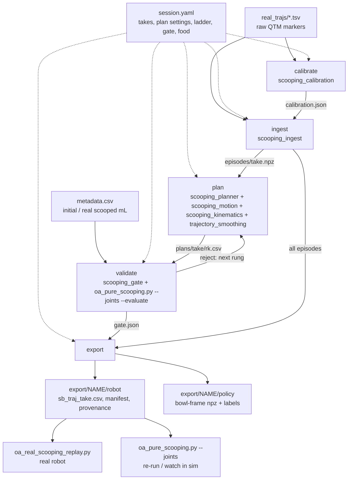
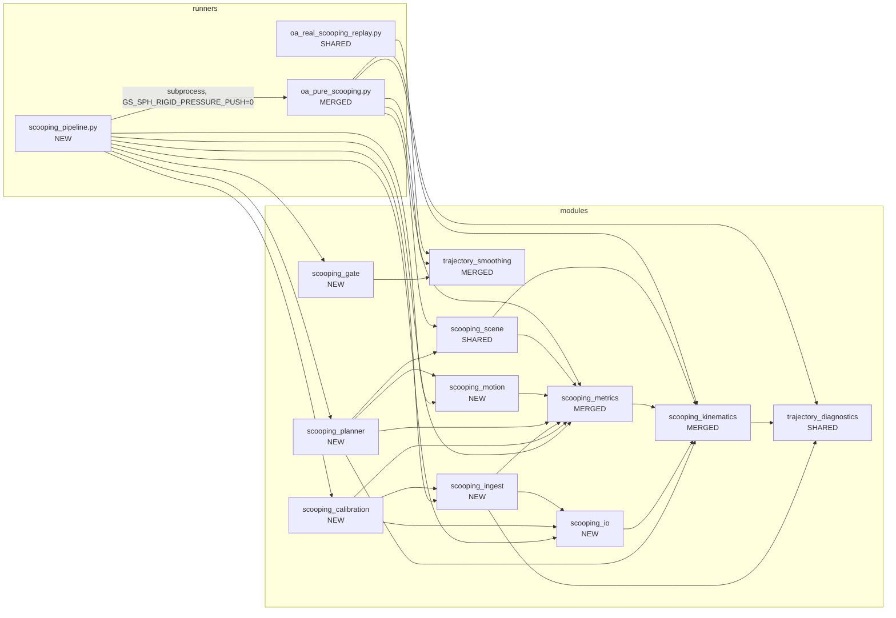

# Post-processing architecture: what links to what

This page is the map of the scooping post-processing code on branch `pipeline-migration` (2026-11-14). It shows
which file calls which, which parts are new, merged from older code, or legacy, and how to run the new trajectories
in simulation.

- What each stage does (settings, phase standard, time bases, file formats): [`docs/scooping_pipeline/README.md`](../scooping_pipeline/README.md).
- Why the pipeline looks like this (critique of the old flow, migration order):
  `data/diagnostics/2026-11-12/pipeline_proposal/README.md`. The folder is git-ignored.
- Validation of the migration: `data/diagnostics/2026-11-12/migration_checks/` and
  `data/diagnostics/2026-11-13/migration_steps_4_5/` (git-ignored).

**Status words used below:**

| Word | Meaning |
|---|---|
| **new** | Written during the migration. It replaces code that lived in dated diagnostics folders |
| **merged** | An existing `scripts/` file, extended with code taken from the diagnostics folders |
| **shared** | An existing `scripts/` file the pipeline uses, with no or only small changes |
| **legacy** | Still in `scripts/` and still runs, but not part of the pipeline |
| **frozen** | Data produced by the old flow. It is kept as it is, for provenance, and nothing writes to it |

## 1. The two flows side by side

**Old flow** (2026-10 to 2026-11-06). About 25 scripts in 5 diagnostics sessions. The demo was converted to
synthetic markers and back to poses several times. Yaw, ×1.6 and the placement were frozen into a marker CSV, and the
selection was a hand-written sheet:

```
real_trajs/*.tsv
  -> sb_common / gb_common / learn_layout / calibrate / rerun_correction_v3   (calibration, per diagnostics session)
  -> prepare.py / wall_margin.py      poses -> markers (yaw 180, x1.6)  -> sim_ready_trajs/sb_XXXX_<cfg>_x1.6_yaw180.csv
  -> oa_pure_scooping.py --trajectory   markers -> poses -> IK -> food sim                       (v1 selection by hand)
  -> sb_robot_trajs/tools/export.py                                                   -> sb_robot_trajs/v1/   (frozen)
  -> replan_bowl.py + bowl_common.py  markers -> poses -> bowl hold, spin -> IK
  -> run_food_sims.py, plot_results.py (selection), floor_lift.py
  -> sb_robot_trajs/tools/export_v2.py                                                -> sb_robot_trajs/v2/   (frozen)
```

**New flow.** One command, `scripts/scooping_pipeline.py`, with five stages. The markers are fitted to poses once.
Everything after that works on poses:



## 2. Code: who calls whom



`oa_real_scooping_replay.py` runs on the system Python with ROS 2. It imports only `trajectory_smoothing`, which is
pure numpy. Every other module needs the `genesis` conda env (numpy, scipy, trimesh / USD, Genesis).

## 3. Every file in `scripts/`

### Pipeline: runners

| File | Status | Role | Where its code came from |
|---|---|---|---|
| `scooping_pipeline.py` | **new** | CLI `calibrate \| ingest \| plan \| validate \| export SESSION.yaml`. Session settings, food model, correction ladder, both exporters | `run_sims.py`, `analyse.py` (2026-10-21); `run_food_sims.py`, `plot_results.py` selection (2026-11-06); `sb_robot_trajs/tools/export.py`, `export_v2.py`, `sim_ready_trajs/tools/export.py`; the hand-written selection sheet |
| `oa_pure_scooping.py` | **merged** | Genesis food simulation and scoop evaluation. New: `--joints CSV` (replays a joint CSV with `--evaluate`); soybean / spoon v3 defaults | absorbed `oa_joint_replay.py` (removed) and `oa_pure_scooping_v3plan.py` (2026-11-06, no longer needed) |
| `oa_real_scooping_replay.py` | **shared** | Real-robot replay. Change: `--blend-window auto`, so a CSV that starts at rest (every pipeline CSV) is replayed unchanged | — |

### Pipeline: modules

| File | Status | Role | Where its code came from |
|---|---|---|---|
| `scooping_io.py` | **new** | QTM TSV reading, lab → world, episode `.npz`/`.json`, joint CSV read / write, SHA-256 | `gb_common.read_tsv / world_markers` (2026-10-13), `sb_common.load / read_types` (2026-10-19) |
| `scooping_calibration.py` | **new** | Bowl marker layout, spoon-vs-bowl ICP, cross-validation gate (< 1 mm) | `learn_layout.py`, `calibrate.py`, `evaluate.py` (2026-10-19), `rerun_correction_v3.py` (2026-10-21) |
| `scooping_ingest.py` | **new** | Robust Kabsch poses, calibration model, phase standard, crop → episode | `sb_common.poses`, `gb_common.analyse / crop`, `prepare.py` (without the marker round trip) |
| `scooping_motion.py` | **new** | Pose edits, no IK: placement / yaw, wall margin (`calwall`), bowl hold, spin, spoon low-pass, floor lift | `wall_margin.py` (2026-10-21), `replan_bowl.py` + `bowl_common.py`, `floor_lift.py` (2026-11-06) |
| `scooping_planner.py` | **new** | `Planner`: episode (or legacy markers) → wrist targets → both arms' IK → rows + plan metrics (clearance, entry clearance, end above rim) | `replan_bowl.py` (2026-11-06) plus the old `oa_pure_scooping` IK path |
| `scooping_gate.py` | **new** | Plan and simulation checks → accept / reject with reasons and warnings | 2026-11-06 `plot_results.scoop_ok / jam`; jam rule from CLAUDE.md |
| `scooping_kinematics.py` | **merged** | numpy IK / FK, `plan_arm` (settled first frame, bowl-arm J2 rule), `check_plan` | J2 rule and `check` from `replan_bowl.py` |
| `scooping_metrics.py` | **merged** | Spoon / bowl geometry (`T_HB`, `TIP`, rim), clearance, scoop success test | clearance geometry from `gb_common` and `sb_common.deepest`: one clearance definition |
| `trajectory_smoothing.py` | **merged** | `smooth_start` (now written into the plan file), `starts_at_rest`, `auto_window` | — |
| `scooping_scene.py` | **shared** | Genesis scene, constants (`DT`, `KP`/`KV`, `SPOONS`), marker templates | — |
| `trajectory_diagnostics.py` | **shared** | `fit_pose` (Kabsch), `Recorder` | — |

### Legacy (still in `scripts/`, not used by the pipeline)

| File | What it is | Proposed (not done; needs your agreement) |
|---|---|---|
| `oa_full_sim.py`, `oa_pick_and_place.py`, `oa_genesis_ik.py`, `oa_ws_reachability.py` | Exploration: grasp / carry the holder, IK tests, workspace | move to `scripts/legacy/` |
| `feeding_mapping.py` | MuJoCo / green-bean-era marker mapping (now in `scooping_io.world_markers`) | remove |
| `compare_replays.py` | One-off comparison hard-coded to 2026-09-23 | remove |
| `convert_usd.py`, `convert_bowl_holders.py`, `make_table_usd.py`, `load_usd_genesis.py` | Asset tools | move to `scripts/assets/` |

Removed on this branch: `oa_joint_replay.py` (use `oa_pure_scooping.py --joints`).

### Legacy entry points that still work inside the merged files

| Entry point | Input | Use it for |
|---|---|---|
| `oa_pure_scooping.py --trajectory CSV` | `sim_ready_trajs` marker CSVs (the old flow) | Re-running a v1-era experiment. IK runs inside the simulation |
| `oa_pure_scooping.py --joint-plan NPZ` | 2026-11-06-style `.npz` joint plans | Old diagnostics only |
| `oa_pure_scooping.py --joints` on a `sb_robot_trajs/v1\|v2` CSV | Frozen robot CSVs, which start moving | Add `--blend-window 0.3` to simulate the robot's smooth start |
| `Planner.targets_from_markers` | `sim_ready_trajs` marker CSVs | The v2 rebuild check only (`migration_steps_4_5/tools/check_step5.py`); not reachable from the CLI |

## 4. Data: inputs, outputs, frozen sets

| Path | Status | Written by | Read by |
|---|---|---|---|
| `data/trajectory/real_trajs/*.tsv`, `181026_soybean_state*.csv` | input | QTM, by hand | `ingest`, `calibrate`; `make_metadata.py` (session tool) |
| `<session>/session.yaml`, `metadata.csv` | input | by hand | every stage |
| `<session>/calibration.json`, `episodes/`, `plans/`, `sim/`, `gate/`, `gate.json` | **new**, per session | the pipeline stages | the next stage |
| `<session>/export/NAME/robot/` | **new** | `export` | `oa_real_scooping_replay.py`, `oa_pure_scooping.py --joints` |
| `<session>/export/NAME/policy/` | **new** | `export` | your policy training (writer for a specific model: not done) |
| `data/trajectory/sim_ready_trajs/` (21 marker CSVs + manifest) | **frozen** | old flow | `oa_pure_scooping.py --trajectory`, the v2 rebuild check |
| `data/trajectory/sb_robot_trajs/v1/`, `v2/` | **frozen** | old exporters (`sb_robot_trajs/tools/`) | real robot (all real runs so far) |
| `real_runs/` | **frozen** records | `oa_real_scooping_replay.py --execute` | analysis (`analyse-real` stage: not done) |

For now sessions live in git-ignored diagnostics folders (your decision, 2026-11-13). The current one is
`data/diagnostics/2026-11-13/migration_steps_4_5/session/`. Its export is `session/export/soybean_2026-10-17/`:
- 23 of 24 takes accepted; 0022 rejected (jams at every rung);
- warnings: 0023 and 0024 (rim entry 2.6 / 3.1 mm; sim keeps < 50 % of the real scoop), 0020 (sim keeps 2.0 of the
  real 9.4 mL at floor lift 5 mm).

## 5. Running the new trajectories in simulation

Run from the repository root, in the `genesis` env. Every food run needs the Genesis patch and
`GS_SPH_RIGID_PRESSURE_PUSH=0`. Run at most 3 GPU food runs at once.

```bash
cd ~/oa_ros2_ws/src/rfa_genesis
conda activate genesis
S=data/diagnostics/2026-11-13/migration_steps_4_5/session
E=$S/export/soybean_2026-10-17/robot
```

### 5.1 Watch one exported trajectory with food (viewer)

```bash
GS_SPH_RIGID_PRESSURE_PUSH=0 python scripts/oa_pure_scooping.py --joints $E/sb_traj_0017.csv \
  --food-volume 56.51 --evaluate --diagnostics sim_runs/new_0017
```

- `--spoon v3` and the soybean food (rho 960, mu 0.01, gamma 0.01, 6 mm, gap 0.030, hold 2, abort at −30 mm) are
  the defaults.
- `--food-volume` is not the real volume. It is `round(initial_food_ml / 0.1275) × 0.1728`. `initial_food_ml` is a
  column in `$E/manifest.csv`. 0017: 41.7 mL → 56.51.
- The exact command the pipeline ran is in `$S/sim/<take>/r<rung>/command.txt` (the rung is in the manifest). Drop
  `--headless` and change `--diagnostics` to watch it again without overwriting the gate's run.
- Results: `scoop_summary.json` (kept mL, particles, peak contact) and `dense_contacts.csv` (jam check) in the
  `--diagnostics` folder.

### 5.2 Rigid-only jam check (no food, CPU)

```bash
python scripts/oa_pure_scooping.py --joints $E/sb_traj_0017.csv --no-liquid --backend cpu --headless \
  --diagnostics sim_runs/new_0017_rigid
```

### 5.3 Re-plan a take with other settings, then simulate it

Change the take's entry in `session.yaml` (`plan: takes:`) or add a ladder rung. Then write the plan to a new
output folder, so the existing plans stay as they are:

```bash
python scripts/scooping_pipeline.py plan $S/session.yaml --out sim_runs/replan --takes 0022     # rung 0
python scripts/scooping_pipeline.py plan $S/session.yaml --out sim_runs/replan --takes 0022 --rung 2
```

`plan` reads `<out>/episodes/<take>.npz`, so copy them first:
`mkdir -p sim_runs/replan && cp -r $S/episodes sim_runs/replan/`. The output is
`sim_runs/replan/plans/0022/r<k>.csv` plus a `.json` with the plan metrics. Simulate it as in 5.1.

### 5.4 Whole session, raw data to export

```bash
python scripts/scooping_pipeline.py calibrate $S/session.yaml
OMP_NUM_THREADS=1 python scripts/scooping_pipeline.py ingest $S/session.yaml
python scripts/scooping_pipeline.py validate $S/session.yaml        # plans, food sims (3 at a time), gate, ladder
python scripts/scooping_pipeline.py export $S/session.yaml --name NAME
```

- Every stage refuses to overwrite earlier output unless `--overwrite` is given. The exception is `validate`, which
  recomputes the gate from the existing plans and simulations; existing simulations are skipped, not re-run.
- For a new recording session, copy `session.yaml` and `metadata.csv` to a new dated folder and change `raw_dir`,
  `takes`, the calibration take and the per-take overrides.
- On this PC, `validate` for the 24 soybean takes took about 2 h, almost all of it in the food simulations (31
  runs, 3 at a time).

### 5.5 Real robot (not from this PC)

```bash
/usr/bin/python3 scripts/oa_real_scooping_replay.py $E/sb_traj_0017.csv --preview-approach   # safe
/usr/bin/python3 scripts/oa_real_scooping_replay.py $E/sb_traj_0017.csv --execute            # your go-ahead
```

The CSV starts at rest, so it is replayed unchanged. The robot runs the same file the simulation validated.

## 6. Decisions recorded 2026-11-14

| Topic | Decision | Effect in code |
|---|---|---|
| Phase threshold `LOW` | Keep 10 mm | No effect on the robot trajectory: the plan uses only the crop (entry, lift). `low0` / `low1` set the policy phase labels (sweep / slide) and the summary statistics |
| Rim-entry clearance | Warn, pass regardless | `entry_rim_clearance` is a warning (< 4 mm) |
| Small sim scoops | Accept with a warning; decide after a real-robot replay | New warning `kept_vs_real`: sim kept volume < 50 % of the weighed real scoop (`kept_warn_frac`, `scooping_gate.py`) |
| 0022 | Leave rejected; batch-fix such cases once the larger dataset exists | none |
| Robot test | Not from this PC | none |
| Merge to main | Not yet | branch `pipeline-migration` |

## 7. Not done yet

- RGB / FT sync and recording (migration step 6) and a model-specific policy writer (step 7).
- `analyse-real`: robot results back into the manifest (`real_robot_tested`) and the ladder.
- Tracked `data/sessions/` instead of diagnostics folders.
- Moving the legacy scripts (section 3) to `scripts/legacy/` and `scripts/assets/`.
- CLAUDE.md still lists `oa_joint_replay.py` and the old defaults. Update it at the merge.
