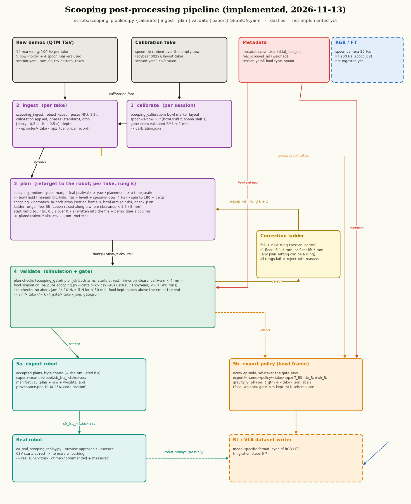

# Scooping post-processing pipeline: human demo → robot joints + policy data

One command per stage takes a session of human scooping demos (Qualisys marker recordings) to:
- **robot joint CSVs** that have passed a food simulation, for `oa_real_scooping_replay.py`;
- **policy data in the bowl frame**, for every demo, labelled with the simulation and robot outcome.



`make_figure.py` draws `pipeline.png`. A dashed border marks a part that does not exist yet.

Implemented on branch `pipeline-migration` (2026-11-12/13), following the plan in
`data/diagnostics/2026-11-12/pipeline_proposal/README.md` §5, steps 1–5. Checks against the existing outputs:
`data/diagnostics/2026-11-12/migration_checks/` (steps 1–3) and `data/diagnostics/2026-11-13/migration_steps_4_5/`
(steps 4–5). Both folders are git-ignored.

**Naming:** "v1 / v2" below means the robot trajectory **sets** in `data/trajectory/sb_robot_trajs/v1|v2`, not a spoon.
The spoon is always named "spoon vN" (`--spoon`; the soybean work uses spoon v3 throughout).

## 1. Quick start

Run from the repository root in the `genesis` env. Food simulations need the Genesis patch (`GS_SPH_RIGID_PRESSURE_PUSH`,
see the main README); `validate` sets the variable itself.

```bash
S=path/to/session/session.yaml
python scripts/scooping_pipeline.py calibrate $S            # once per session (marker / bowl / spoon mount setup)
python scripts/scooping_pipeline.py ingest $S               # every take -> episode
python scripts/scooping_pipeline.py plan $S                 # base plan (rung 0) per take; optional, validate plans too
python scripts/scooping_pipeline.py validate $S             # food simulation + gate + correction ladder
python scripts/scooping_pipeline.py export $S --name soybean_2026-10-17   # robot CSVs + manifest + provenance; policy data
```

Outputs go next to `session.yaml`, or to `--out DIR`. A stage refuses to overwrite earlier output unless you pass
`--overwrite`. The one exception is the gate files, which `validate` recomputes from the existing plans and
simulations on every run.

On a 32-core machine, set `OMP_NUM_THREADS=1` for `ingest`. Its 16 worker processes otherwise oversubscribe the CPU
(load above 100), and it becomes several times slower.

The example session (the 2026-10-17 soybean takes) is
`data/diagnostics/2026-11-13/migration_steps_4_5/session/session.yaml`.

## 2. Inputs

| Input | What | Where it is set |
|---|---|---|
| Raw demos | QTM TSV export per take: 14 markers at 100 Hz. Used: the 5 bowl-holder markers (`Bowl_center`, `Bowl_rim_1..4`) and the 4 spoon markers | `raw_dir`, `tsv` (pattern with `{take}`), `takes` |
| Calibration take | The spoon tip rubbed over the empty bowl (soybean0029), plus the takes used to learn the bowl marker layout. Record one at the start of every session | `calibration: take, layout_takes, parts` |
| Metadata | `metadata.csv`: `take, initial_food_ml, real_scooped_ml` (weighed), plus free columns | `metadata` |
| Food model | Simulation food per food type. Default: soybean pudding (rho 960, mu 0.01, gamma 0.01, 6 mm particles, validated 2026-10-26) | `food:` |
| Robot / spoon | Spoon version (v3 for the soybean work). Its mesh measures the demo and the robot uses it | `spoon` |
| Plan settings | Defaults below; overrides per take under `plan: takes:` | `plan:` |
| Correction ladder | List of plan-setting overrides, tried in order after a failure | `ladder:` |
| Gate thresholds | `scooping_gate.GATE_DEFAULTS` overrides | `gate:` |
| RGB / FT | Not ingested yet (migration step 6) | — |

## 3. Stages

### 3.1 `calibrate` (per session) → `calibration.json`
`scooping_calibration.py`:
1. **Bowl marker layout:** the measured positions of the 5 bowl markers in the holder frame, averaged over the layout
   takes.
2. **Spoon-vs-bowl fit:** robust point-to-plane ICP of the spoon mesh against the inner bowl surface, using the
   calibration take's frames with the tip inside the rim. The parameters are a bowl shift `t` (holder frame) and a
   spoon shift `s` ({S}).
3. **Gate:** the cross-validated RMS must be under 1 mm (2026-10-17 session: 0.75 mm). If it fails, record the
   calibration take again before you record demos.

### 3.2 `ingest` (per take) → `episodes/<take>.npz` + `.json`
`scooping_ingest.py`. The episode is the canonical, robot-independent record of a demo: it contains no yaw, no
placement and no time scale.
1. Lab mm → world m. Gap-filled frames are flagged.
2. **Robust poses** `H(t)` (bowl holder) and `S(t)` (spoon {S}) by Kabsch:
   - the bowl uses the session's measured marker layout;
   - a mislabelled bowl marker is dropped;
   - frames that are still bad are interpolated (Slerp).
3. **Calibration:** `rel_cal = C · H⁻¹S · T_s`, the spoon pose in the holder frame.
4. **Phases**, on the calibrated pose (the standard is in §5).
5. **Crop** to [entry − 0.5 s, lift + 0.5 s]. The QTM time of the first kept frame is stored as `t_qtm0`.
6. **Depth:** the deepest spoon point inside the bowl surface, before and after calibration.

Episode arrays:
- `t`, `H`, `raw` (uncalibrated `rel`), `cal` (`rel_cal`);
- `depth_raw`, `depth_cal`, `phase`, `idx`;
- `t_qtm0`, `crop`;
- fit residuals, `not_gap_filled`.

The `.json` file holds the phase times, the clearance summary and the source (TSV SHA-256, QTM header,
calibration).

### 3.3 `plan`: retargeting to the robot → `plans/<take>/r<k>.csv` + `.json`
`scooping_planner.py`, `scooping_motion.py` and `scooping_kinematics.py`. Rung `k` = the base settings (`r0`) or
ladder entry `k`. The steps run in this order:

| # | Step | Frame / effect | Setting |
|---|---|---|---|
| 1 | Spoon margin | `cal`: as recorded. `calwall`: spoon pushed off the surface, 0.5 mm near the axis to 3 mm on the wall (holder frame) | `spoon_margin` |
| 2 | Yaw and placement | Holder poses turned about the vertical through the first `Bowl_center`, which is then moved to `placement` (world) | `yaw_deg`, `placement` |
| 3 | Time scale | Demo time × `time_scale` (1.6: every validation so far ran at ×1.6) | `time_scale` |
| 4 | Bowl hold | Flat demos (own tilt < 5°): one level pose. Tilted demos: one min-jerk tilt to the mean scoop pose, then held. Spoon-in-bowl pose de-spiked and low-passed at 4 Hz | `bowl: hold` (or `demo`) |
| 5 | Spin | Bowl turned about its own axis to 180° + δ. δ is the first value in 0, ±2, …, ±10 whose bowl-arm plan passes the check | `spin` |
| 6 | IK, both arms | Settled first frame. Bowl-arm J2 rule: a J2 below −90° is re-solved from the usual pose. 4 ms rows | — |
| 7 | Floor lift (ladder) | Spoon raised along the bowl normal `e` wherever the planned clearance is below the threshold; smooth ramps; spoon arm re-planned | `floor_lift_mm` |
| 8 | Start ramp | `trajectory_smoothing.smooth_start`: the first 0.3 s retimed over 0.7 s (quintic). The joint path is unchanged and the file **starts at rest** | `start_ramp: [0.3, 0.7]` |

Defaults (`PLAN_DEFAULTS`): `cal`, `hold`, spin on, yaw 0, placement (0.22, −0.04, 0.44), ×1.6, ramp [0.3, 0.7],
no floor lift. The 2026-10-17 recordings face the other way, so their session sets yaw 180 (0009: 200 at
(0.22, 0, 0.44)).

Plan CSV:
- `time_from_start_s`, `openarm_left_joint1..7`, `openarm_right_joint1..7` (rad), 4 ms rows, `%.6f`;
- a last column `demo_time_s`: the QTM time of the take that each row shows, ramp included.
  - A robot or simulation sample at plan time `t_p` maps to demo time and phase through it, and so to the human
    demo's FT / video once those are synced.
  - Readers that use column names (`oa_real_scooping_replay.py`, `oa_pure_scooping.py --joints`) ignore it.

Plan JSON:
- the settings, the plan choices (flat, spin δ, tip-back, floor lift), the per-arm IK metrics and the plan metrics;
- the plan metrics include `min_clearance_mm`, `entry_min_clearance_mm` (clearance while the dish enters the bowl),
  `end_spoon_above_rim_mm`, peak speeds, margins and `start_speed_rad_s`;
- the source episode's SHA-256.

### 3.4 `validate`: food simulation, gate and ladder → `sim/`, `gate/<take>.json`, `gate.json`
For each take, rung by rung:
1. Plan the rung.
2. Run the plan checks. A take that fails one goes to the next rung.
3. Simulate the plan with food: `oa_pure_scooping.py --joints r<k>.csv --evaluate`, with the session's food model
   and `--food-volume` from `initial_food_ml`. At most 3 GPU runs at once.
4. Run the simulation checks.
5. Accept the take, or try the next rung. When every rung fails, the take is rejected with the reasons.

`scooping_gate.py`:

| Check | Level | Rule | Origin |
|---|---|---|---|
| `plan_ok` | reject | both arms: IK within tolerance, joints ≥ 5° inside the limits, raw IK step ≤ 5°, bowl-arm J2 ≥ −90° | 2026-11-06 replan check, now on both arms (user, 2026-11-13) |
| `start_at_rest` | reject | first-step joint speed < 0.05 rad/s (only when the plan has a ramp) | step 4 |
| `entry_rim_clearance` | warn | planned spoon–bowl clearance while the dish enters the bowl ≥ 4 mm | 2026-11-13 rim_entry_check: only 0023 / 0024 (2.6 / 3.1 mm) are below; both touched the rim on the robot (v1 failed, v2 succeeded) |
| `not_aborted` | reject | the simulation's safety gate did not abort | v2 selection |
| `jam` | reject | peak contact < 10 N, and > 5 N for < 50 ms | CLAUDE.md |
| `food_kept` | reject | at least one particle on the spoon at the end | v2 selection |
| `end_above_rim` | reject | spoon above the rim plane at the end, in the bowl frame | v2 selection |

- Kept volume is reported but not gated: one GPU run has about ±1 mL of run-to-run noise.
- Default ladder for the soybean session: floor lift 1.5 mm, then 5 mm. These are the 2026-11-06 fixes for the two
  floor jams (0017 needs 1.5 mm, 0003 needs 5 mm). They keep about 30 % less food.
- Any plan setting can be a rung, e.g. `{time_scale: 2.0}`, `{spoon_margin: calwall}` or `{placement: [...]}`.

### 3.5 `export --name NAME` → `export/NAME/`
**Robot** (`robot/`), the accepted takes only:

| File | Content |
|---|---|
| `sb_traj_<take>.csv` | Byte copy of the accepted plan: the same file the simulation ran |
| `manifest.csv` | Per take: rung, configuration, bowl / spin / placement / yaw / time scale / ramp / floor lift, samples, duration, flat, tilt, tip-back, spin δ, margins, planned and entry clearance, peak speeds, simulated kept mL and peak contact, initial food and real scooped mL, gate warnings, `real_robot_tested` (filled by hand) |
| `provenance.json` | Code revision, session / calibration / gate SHA-256, gate thresholds and food model, rejected takes with reasons, and per file the plan, its source episode, the simulation and every SHA-256 |

**Policy** (`policy/`), every ingested episode, whatever the gate says:

| File | Content |
|---|---|
| `<take>.npz` | In bowl frame B: `T_BS` (spoon {S} in B, calibrated), `tip_B`, `dish_B`, `gravity_B` (world −z in B, i.e. the bowl tilt), `T_WB`, `depth_mm`, `phase`, `phase_idx`, `t`, `t_qtm` |
| `<take>.json` | Labels: food, initial and real scooped mL, demo summary (phase times, tilt, curl, clearance), gate status / rung / reasons, simulated kept mL and peak contact, robot file; source SHA-256 |
| `index.csv`, `schema.json` | One row per episode; frames and fields |

Bowl frame B (`scooping_metrics.T_HB`):
- origin at the bowl floor centre;
- z_B along the bowl axis, out of the bowl;
- x_B = −x_holder;
- rim at z_B = 41 mm, rim radius 72.7 mm.

The policy data is model-agnostic. The writer for a specific model (LeRobot, RLDS, …) and the RGB / FT streams are
migration steps 6–7.

### 3.6 Real robot
```bash
source /opt/ros/jazzy/setup.bash          # feeding bringup running in another terminal (CLAUDE.md)
/usr/bin/python3 scripts/oa_real_scooping_replay.py export/NAME/robot/sb_traj_0001.csv --preview-approach
/usr/bin/python3 scripts/oa_real_scooping_replay.py export/NAME/robot/sb_traj_0001.csv --execute   # user's go-ahead
```
`--blend-window` defaults to `auto`:
- A pipeline CSV starts at rest, so it is replayed unchanged: `commanded.csv` equals the file, and the simulation
  ran the same motion.
- A v1 / v2 CSV starts moving (0.17–6.4 rad/s), so it still gets the 0.3 → 0.7 s smooth start, as before.
- The rule is `trajectory_smoothing.starts_at_rest`: the first step is below 0.05 rad/s.

## 4. Time bases

| Time | Where | Relation |
|---|---|---|
| QTM time | raw TSV `Time`; `t_qtm0`, `t_qtm`, `demo_time_s` | master clock of a human demo (FT / video sync key) |
| Episode time `t` | episodes, policy data | `t = QTM − t_qtm0` (starts at entry − 0.5 s) |
| Plan time `time_from_start_s` | plan / robot CSV | `t_p = ramp(time_scale · t)`. After the ramp (0.7 s): `t_p = 1.6 · t + 0.4 s`. The ramp ends before the spoon enters the bowl |
| Robot time | `real_runs/*/measured.csv` | `t_r − start ≈ t_p` + tracking lag (tens of ms) |

## 5. Phase standard (`scooping_ingest`)

All phases use the calibrated dish tip (`scooping_metrics.TIP`) relative to the bowl.

| Index | Definition |
|---|---|
| `entry` | First frame with the tip inside the rim cylinder: below the rim plane in B and radius < 72.7 mm |
| `low0` / `low1` | First / last frame of the longest stretch after entry with the tip within 10 mm of the inner surface. Stretches closer than 0.2 s are merged |
| `deep` | Lowest tip, relative to the surface, between `low0` and `low1` |
| `c0` / `c1` | Curl: the spoon's face-up angle (world vertical vs {S} +z) has dropped by 10 % / 90 % of its total drop after its peak |
| `lift` | First frame after `low1` with the tip above the rim plane |

- **Required order:** entry ≤ low0 ≤ deep ≤ low1 < lift, and entry ≤ c0 ≤ c1 ≤ lift. Ingest rejects a take that
  violates it. The curl may start before `low0` (0010).
- **Per-frame labels:** approach → descent → sweep → curl → slide → lift → out.

## 6. Data layout of a session folder

```
session.yaml, metadata.csv
calibration.json, calibration_frames.npz            calibrate
episodes/<take>.npz + .json, ingest.json            ingest
plans/<take>/r<k>.csv + .json, plan_r0.json         plan / validate
sim/<take>/r<k>/  (oa_pure_scooping diagnostics, command.txt, run.log)
gate/<take>.json, gate.json                         validate
export/<name>/robot/  sb_traj_<take>.csv, manifest.csv, provenance.json
export/<name>/policy/ <take>.npz + .json, index.csv, schema.json
```

For now, sessions live in git-ignored diagnostics folders (user decision, 2026-11-13). The robot sets that are in
use stay frozen in `data/trajectory/sb_robot_trajs/v1|v2`.

## 7. Code map

| Module | Role |
|---|---|
| `scooping_pipeline.py` | CLI: `calibrate`, `ingest`, `plan`, `validate`, `export`; session settings, food model, exporters |
| `scooping_io.py` | QTM TSV reading, lab → world, episode and joint-CSV read / write |
| `scooping_calibration.py` | Bowl layout, ICP, cross-validation, calibration gate |
| `scooping_ingest.py` | Robust poses, calibration model, phases, crop, `ingest_take` |
| `scooping_motion.py` | Pose edits: placement / yaw, wall margin, bowl hold, spin, spoon low-pass, floor lift |
| `scooping_planner.py` | `Planner`: targets → plan both arms (spin choice, floor lift) → rows, plan metrics |
| `scooping_kinematics.py` | IK / FK, `plan_arm` (settled start, J2 rule), `check_plan` |
| `scooping_gate.py` | Plan and simulation checks, decision |
| `trajectory_smoothing.py` | Start ramp, `starts_at_rest` |
| `scooping_metrics.py`, `scooping_scene.py` | Geometry and clearance; scene, constants |
| `oa_pure_scooping.py` | Simulation (`--joints` for plan CSVs) |
| `oa_real_scooping_replay.py` | Real-robot replay |

What it replaced:
- about 25 files in 5 diagnostics sessions: `gb_common`, `sb_common`, `learn_layout`, `calibrate`,
  `rerun_correction_v3`, `prepare`, `wall_margin`, `replan_bowl`, `bowl_common`, `floor_lift`, `run_food_sims`,
  `plot_results` (selection), the 3 exporters;
- `oa_joint_replay.py` (removed);
- the hand-written selection sheet.

## 8. Validation (summary; details in the two check sessions)
- Ingest + calibration reproduce `prep_XXXX.npz` bit for bit with the old calibration values. The re-fitted
  calibration differs from `x_v3` by ≤ 0.066 mm and is now used (user decision).
- From the v2 inputs, the planner reproduces all 19 v2 trajectories bit for bit, including the 0010 J2 re-solve. The
  floor lift reproduces the 2026-11-06 lift plans (0017 at 1.5 mm, 0003 at 5 mm) bit for bit.
- `oa_pure_scooping --joints` gives the v2 kept volume and peak contact within the GPU run-to-run noise (±1 mL).
- Exporter (step 5): v2 rebuilt from the v2 inputs under a new name gives 18 files, all byte-identical to v2, and the
  same simulation selection (0003 and 0017 rejected for jams).
  - The 19th, 0023, is rejected by the both-arm `plan_ok` check: spoon-arm raw IK step 5.16° > 5°. The user
    decided to keep that check.
  - 0023's plan file itself is byte-identical to v2.
- Full run of the 2026-10-17 session from raw data (24 takes): 23 accepted.
  - Base plan: 20 takes. Floor-lift ladder: 0017 at 1.5 mm, 0003 and 0020 at 5 mm.
  - 0022 is rejected (jams at every rung).
  - New candidates: 0015, 0020.
  - Details: `data/diagnostics/2026-11-13/migration_steps_4_5/README.md`.

## 9. Not done yet
- Sync and recording of RGB / FT, for the human demos and the robot replays (rosbag2, saved `start` stamp): step 6.
- A policy dataset writer for a specific model: step 7.
- `analyse-real`: robot results back into the manifest and the ladder.
- Moving sessions to a tracked `data/sessions/`.
